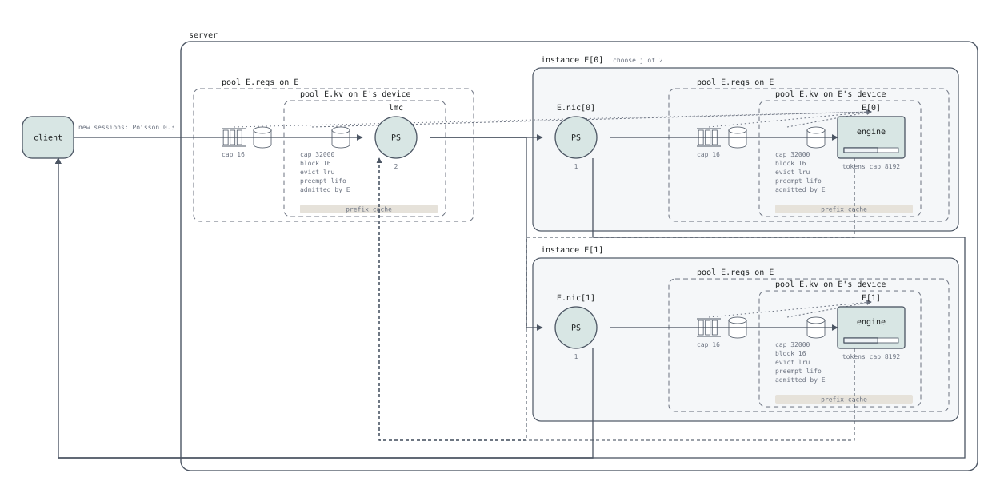

# An engine's link to an L2

An L2 KV cache outside the engines (an LMCache server, a Mooncake store) is
shared: what one engine saves, another loads. Its links are not: each
engine reaches the server over its own NIC. Before this change an engine's connector copied through
the L2 queue's `serve` alone, so one `serve` was every engine's link at once,
and a program could not say "a copy goes at one link's speed, and the
engines do not slow each other". `kvt.l2_link (C, Q, share = s);` says it.
Issue #600; no IR change.

## Before

The issue's pair, two engines sharing one L2 (main `d50ac83`). A session's
first turn saves 1008 tokens on one engine (`floor(1008 + 1, 16)`), its
second loads 1007 of them on the other (`min(floor(1008, 16), 1008 - 1) -
hit 0`: all but the last token) at 1e-4 s a token, 0.1007 s over a link of
its own. `load_time` is the copy alone, no iteration around it:

```serq
queue lmc : l2 { device host { kv cap 1e6; } pool kv on host { block 16; evict lru; } serve ps(links); }
queue E[2] : agg {
  device gpu { compute (t) = t * 1e-6; hbm (k) = 1e-3; kv cap 1e5; }
  engine on gpu {
    …
    connector lmc {
      per_token (1e-4);
      load (request.preempted ? 0 : max(0, min(floor(cachedin(lmc.kv), 16), request.known - 1) - request.hit));
      save (floor(request.input + request.output, 16));
    }
    …
  }
  pool reqs on E { queue fifo; }
  pool kv on E.gpu { block 16; evict lru; preempt lifo; }
  decode (prompt) { E (prompt, 1); }
}
server (K, t0) {
  set e = serial - 2 * floor(serial / 2);   // the session's first engine
  E[K == 0 ? e : 1 - e].decode (1008);
  if (K == 1) { observe load_time = E.load_done - t0; }
}
```

`load_time` of the second turn, `serq run … --horizon 100 --links L --n N`
(`--n 2`: two sessions, the two engines loading at once):

| `serve` | one load | two engines load at once |
|---|---|---|
| `ps(1)` | 0.1007 | **0.2014** |
| `ps(2)` | **0.0504** | 0.1007 |

With a link per engine all four would be 0.1007. With `ps(1)` the other
engine's copy takes half of mine; with `ps(2)` one copy goes at two links'
speed. An engine queue's `nic` was no way out: a `nic` no copy crosses is
refused (`E-nic-unused`, #617), and since #592 a copy is a connector's,
not a `run` the program writes.

## Where the links are

vLLM's KV connector has a scheduler side and a worker side, and the worker
side "runs in each worker, loads/saves KV cache to/from the Connector"
(`kv_connector/v1/base.py:25-26`): each engine's workers copy over that
node's own link. The LMCache connector the example models reaches a server
its configuration names, "lmcache.mp.host: the host of the LMCache server"
(`lmcache_mp_connector.py:465-466`), read into one `server_url`
(`lmcache_mp_connector.py:481-498`) to which the worker side connects
(`lmcache_mp_connector.py:509-511`): engines configured with one host share
one server. The contents are one; the copies are each engine's.

## After

The engine's queue declares its link, and a relation of std/kvt says its
connector's copies cross it:

```serq
queue lmc : l2 { device host { kv cap 1e6; } pool kv on host { block 16; evict lru; } serve ps(bw); }
queue E[2] : agg {
  …
  nic ps(1);   // the engine's own link to the L2
  …
}
kvt.l2_link (lmc, E, share = share.bottleneck);
```

It lowers to the transfers' fields #719 gave every connector: each member's
load and save hold the L2's stage and the member's NIC at once,
`CTransfer.also = [E.nic[j]]`, `share = Some(Bottleneck)`, no `poster`. For
member `j`, the kernel is

```serq
run lmc, E.nic[j] (cost(lmc, E.nic, E.loaded * 1e-4), share = share.bottleneck);
load E.kv[j] (cost(E.kv, E.loaded));
…
hold lmc.kv (cost(lmc.kv, cachedin(lmc.kv))) {
  grow lmc.kv (cost(lmc.kv, max(0, E.saved - cached)));
  run lmc, E.nic[j] (cost(lmc, E.nic, max(0, E.saved - cached) * 1e-4), share = share.bottleneck);
  load lmc.kv (cost(lmc.kv, max(0, E.saved - cached)));
} cache (cost(lmc.kv, E.saved));
```

The Before program with `nic ps(1);` in `E` and this relation below it
(`use "std/kvt"; use "std/share";` added), the same command, `--links L`
for the L2's `serve ps(L)` (`tests/l2_link.rs`, `deployment`):

| L2 `serve` | one load | two engines load at once |
|---|---|---|
| `ps(1)` | 0.1007 | 0.2014 |
| `ps(2)` | 0.1007 | 0.1007 |

With an L2 as fast as the two links together, a copy goes at its link's
speed and neither engine slows the other: the issue's expectation. With
an L2 as fast as one link the L2 is the limit, and the program says that
too. `share.maxmin` gives the same numbers here (each copy's tightest
stage is its own NIC or the L2 the two hold alike). `tests/l2_link.rs`
holds both tables.

The issue's After wrote the L2 side `serve delay`, "no limit". A stage
held at once with another is a flow's, and a flow's stages are `ps(φ)`
with a constant φ (`Program::validate_flows`): `serve delay` is refused,
"stage `lmc` is held with another stage by one run, so its capacity is
shared: it must be `ps(φ)`". The program writes the L2's real total
bandwidth instead; a φ at least the sum of the links never binds.

## The program that uses it

`examples/multi-turn/vllm_lmcache_replicas.sq`: `vllm_lmcache.sq`'s engine
as `queue E[J] : agg` (less its long_prefill_token_threshold, whose test
reads `waiting.count`, which a family's engine may not), two replicas, each
`nic ps(1)`, one `queue lmc : l2`
with `serve ps(l2_bw)`, `kvt.l2_link (lmc, E, share = share.maxmin)`, and a
turn sent to the least loaded replica (`examples/workloads/chat.sq`), so a
turn's prefix saved on one replica is often loaded on the other. Seed 1,
`--horizon 2000 --warmup 200`, the mean time a request waits for its load
(`waiting_for_kv`) and the client's `ttft`, against the same deployment
without `nic` and relation:

| `l2_bw` | with the link: `waiting_for_kv`, `ttft` | without: `waiting_for_kv`, `ttft` |
|---|---|---|
| 1 | 0.0368, 0.03606 | 0.0368, 0.03606 |
| 2 | 0.0342, 0.03477 | 0.0179, 0.02472 |
| 4 | 0.0342, 0.03477 | 0.0088, 0.01958 |

At one link's bandwidth the L2 binds either way, and the two runs are the
same run. Past it, without the link a copy goes as fast as the server,
four links' speed at `l2_bw = 4`; with it, at its replica's link, and the
server's bandwidth past two links buys nothing.



The figure boxes each replica with its link (`E.nic[j]`, `E[j]`); the L2 is
outside the boxes, every replica's. The view walked a save's statements
with member 0's references, so `E.nic` was owned by `E[j]` through the load
and by `E[0]` through the save, and no box held it; the save is now walked
as the call's member (`as_called`), as the load was. No other figure moves.

## Decisions

**A relation, not a clause in the connector.** serQ says which stages a KV
copy holds at once, and the policy that divides them, with a std/kvt
relation between two queues (`kvt.nixl_pull`, `kvt.nixl_push`); the
connector says how much moves. A clause `over nic, share = …;` inside the
connector would give "the policy of a copy's stages" a second place to be
written (one meaning, one spelling). The links to one L2 are one fabric
across queues, so the relation stands beside the other relations, below
both queues.

**The save crosses the link too, the same stage.** The worker side loads
and saves (`kv_connector/v1/base.py:25-26`); the L2's `serve` carries both
directions as one stage, and the link follows it.

**No `poster`.** A load and a save go opposite ways over the same two
stages. The figure's mark (a pull's dot over the poster's NIC) would mark
both copies with one side, false for one of them; the IR's `poster` doc
says "Absent: no side is named".

**No `latency`, no `ttl`.** `latency` is the wait to post a NIXL READ, `ttl`
how long a source keeps an unread send; an L2 copy has neither, and no
program asks for a wait. Refused: "`kvt.l2_link` takes `share = …`, found
`latency`". Allowing one later is a looser check, which costs nothing now.

**`share` required.** As for NIXL: concurrent copies divide the L2's `serve`
and the NICs by the policy the relation names, with no default.

**One fabric, one policy: the IR's rule, not a copy.** Two engine queues
linked to one L2 with two policies are refused by `Program::stage_shares`
("one fabric has one policy"), as NIXL relations are. A frontend copy of the
rule would be a rule kept in two places.

**The refusals' codes are NIXL's.** An undeclared queue is
`E-copy-no-queue`, a queue with no `nic` `E-copy-no-nic`, a queue whose
engine has no `connector C` `E-copy-no-connector` (a help, no fix-it: what
moves is the program's), and the two written the wrong way round
`E-copy-swapped`, whose fix-it swaps them (`fix.rs::swap`). A first queue
that plays no `l2` (when the second does not either) and a link written
twice are plain errors, the second naming where the first is written.
`E-nic-unused`'s help names the link.

**One table of std/kvt's relations.** `KVT_RELATIONS` (parser.rs) lists the
three functions, their mode (`KvtMode`, which the outline names `pull`,
`push` or `link`), their two queues' names and the arguments each takes by
name; `kvt_call`, the statement form's refusal, the outline's `mode` and
the swap fix-it's label read it.

## Cost

- IR: none. `CTransfer.also`, `share` and `poster` exist since #719, and the
  NIXL connector fills them; IR_VERSION stays 15.
- Lean: none. The generator stops at a connector (`Fragment`) and at
  families; no new `CExpr` or `CStmt`.
- Frontend: the relation's parse and checks (`Parser::l2_link`), the
  lowering's `also` (`l2_copy`), and a save lowered as its member as a load
  is, by one function (`member_transfer`): the save's amount was lowered
  outside the member, so it could not read the member's pools
  (`cachedin(E.kv)`) as a load can.
- View: a save walked as its call's member.
- `tools/metrics.json`: the new example repeats two lines of the other
  replicas' programs (its device and its KV pool).

## Interaction with #599

#599 lets an engine have several connectors. The relation names the pair
(`C`, `Q`), so it picks the connector to `C` among them, and a `Q` whose
engine has none is `E-copy-no-connector`, whatever other connectors it
has.

## Self-critique

**One stage for both directions.** A NIC is full duplex; the
link here, as the L2's `serve`, is one stage a load and a save divide. A
program where saves and loads overlap heavily sees the link half as fast as
it is. Two stages per link (an `in` and an `out`) would be a second NIC
per queue and a direction per copy; nothing measured asks for it yet.

**`delay` refused on the L2 side.** The issue's After wanted "no limit" at
the L2. A flow over a `delay` stage would need the flow solver to treat a
stage with no capacity, a change of what a flow means (an IR version and a
construct for the Lean generator). Writing the server's bandwidth is the
honest form, and a large φ is "no limit".

**Two statements about one pairing.** The connector names the L2, the
relation names the link: a program can write the connector and forget the
relation. It still links, the L2's `serve` alone carrying the copies, which
is what it meant before #600. A `nic` with no relation does not link, and
its help names `kvt.l2_link`.

**The argument order mirrors NIXL's though the bytes go both ways.** "The
source first, as the bytes go" holds for a load, not a save. The L2 comes
first because it is what the link reaches, and the swap fix-it says so.

**One `nic` for every copy of a queue.** The link is the queue's `nic`, the
NIC a NIXL relation's copies cross too. A prefiller that saves to an L2
(`connector lmc { … save (…); }`, `kvt.l2_link (lmc, P, …)`) while its
decoders read from it (`kvt.nixl_pull (P, D, …)`) holds `P.nic` for both:
the NIXL reads and the L2 saves divide one NIC, and the stages `lmc`,
`P.nic` and `D.nic` are one fabric, so the link's policy must be the
relation's ("runs join the stages `lmc`, `P.nic`, `D.nic` … one fabric has
one policy", `tests/l2_link.rs`). That is right where the store is reached
over the same NIC as the peers (Mooncake over RDMA); a link of another kind
(a PCIe to a CPU tier on the node) beside a NIXL NIC cannot be written, as
it would need a second link per queue. No program asks for it, and the
spec names the link a NIC.

**The fabric rule's message points at a generated run.** Two links to one
L2 with two policies are refused at the second link's copy, a run the
program did not write; the message names the stages joined, not the two
relations.

**The name.** `l2_link` sits beside the `link` role, a queue whose `serve`
is a transfer's cost. The two are not the same thing: a `link` queue is a
fabric of its own, an L2 link is an engine's `nic`. `l2_nic` was the other
candidate; `link` says what the program models.

**Rejected: an L2 per node.** A family of L2 queues, one per engine, would
give each engine its own bandwidth and its own contents: what one replica
saved, the other could not load, which is the case the issue is about.

**Rejected: a clause in the connector** (above): a second place for a
copy's policy.
