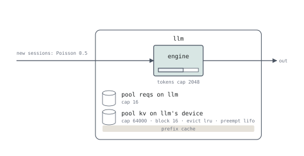

# 5. The engine

Replace the per-turn service time with an engine. Each iteration
allocates a token budget across the requests it is running and then admits waiting
requests with the remaining budget. This model allows prefill and decode
to share an iteration.

## The program

```serq title="docs/tutorial/programs/05-engine.sq"
--8<-- "docs/tutorial/programs/05-engine.sq"
```

Its deployment, drawn by [`serq draw`](../visualization/index.md):



## The engine on its device

The `stage engine` of chapters 3 and 4 is now an `engine`, and `engine` is
the word that declares one, so the engine is named `llm`. Leaving its
admission aside for now:

```serq
device gpu {
  compute (t) = t * alpha;
  hbm (k) = omega + beta * k;
  kv cap blocks * bs;
}
pool kv on gpu { block bs; evict lru; preempt lifo; }
engine llm on gpu {
  reqs cap max_seqs;
  tokens cap B;
  scheduler {
    advance running;
    admit waiting while (running.preempted == 0)
      taking …;
  }
  worker {
    forward (max(hbm(batch.kv_decode + batch.kv_prefill), compute(batch.tokens)));
  }
}
pool reqs on llm { queue fifo; }
```

The `device` says what the hardware offers: the time to compute `t`
tokens, the time to read `k` tokens of KV, and the KV capacity. `pool kv
on gpu` is the device's memory, with its rules: blocks, eviction,
preemption. The `engine` says what runs on it. `reqs cap` is how many
requests may run at once (`max_num_seqs`), `tokens cap` the tokens one
iteration may schedule (`max_num_batched_tokens`). `pool reqs on llm`
holds the engine's `reqs cap`: its running slots, and the queue of
requests waiting for one, served `fifo`.

`scheduler` is what each iteration does: give the running requests their
tokens, then admit waiting ones while nothing was preempted. `taking` says
what an admission takes of a request, below. `worker` is how long the
iteration takes, as an expression in what it scheduled:

| Value | Meaning |
|---|---|
| `batch.tokens` | tokens scheduled this iteration |
| `batch.decoding` | decoding requests scheduled |
| `batch.prefilled` | prefill tokens scheduled |
| `batch.kv_decode`, `batch.kv_prefill` | memory held by the scheduled decode / prefill requests |
| `batch.attention` | attention work of the prefill chunks, \(\sum n(K + n/2)\) |

The cost is the larger of the time to read weights and KV memory and the
time to compute the scheduled tokens. Fit these parameters to measurements
of the engine you want to model. `each at most (c)` limits each request's
prefill in an iteration, and `advance running` takes an order and an
`only`; see [Engines on devices](../language.md#engines-on-devices).

## What the engine does with one request

The engine keeps each request's state, as vLLM's scheduler does: the
tokens it has, `request.known` (its prompt, `request.input`, and what it
has generated), and how many of them have KV. Each iteration it computes
what has no KV yet, a chunk of the prompt as the budget allows, and when
they all have it samples a token; after that it decodes one token per
iteration until it has generated `request.output`. Prefill and decode are
that one rule with many tokens left or one.

## What an admission takes

```serq
admit waiting while (running.preempted == 0)
  taking reqs (1), kv (min(request.known, request.hit + budget_left(llm)))
    reserve (request.known)
  reuse (floor(request.known - 1, bs))
  cache (request.input + request.output);
```

`taking` sits on `admit waiting` because that is when the scheduler sizes
the request: it reads the request at the moment the iteration admits it,
not when it arrived. A prefix may be evicted while the request waits.

**`reuse (floor(request.known - 1, bs))`** is how much of its tokens the
cache may supply: whole blocks, never the last token, which is computed
again for its logits. `request.hit` is what the cache does supply,
`min(cachedin(kv), reuse)`, read when the request is admitted; the engine
computes the rest.

**`reqs (1)`** is one running slot.

**`kv (min(request.known, request.hit + budget_left(llm)))`** is the blocks
of the reused prefix plus the prefill chunk the iteration's budget still
allows, capped by the tokens the request has. `budget_left(llm)` is the
token budget left after serving the running requests. The KV pool grows
with the request as it computes, block by block.

**`reserve (request.known)`** admits the request only if every token it
has fits beside the memory the running requests hold, although only the
first chunk is allocated. This is vLLM's default
(`scheduler_reserve_full_isl`). Without it, a long prompt is admitted on
its first chunk and its later chunks preempt other requests; at the loads
of the next chapter, that raises the preemption count about tenfold.

**`cache (request.input + request.output)`** leaves the request's
sequence cached when it ends, for the session's next turn, as in chapter
4.

With `preempt lifo`, a growth that does not fit preempts the most recently
admitted running request. It goes back to the head of the queue keeping
the tokens it has, and when it is admitted again computes their KV again
and generates only the rest (vLLM's `_preempt_request`).

Waiting requests are admitted only by `admit waiting`, in an iteration,
with the budget left, and never in an iteration that preempted: `pool reqs
on llm` hands the pool's queue to the engine's scheduler.

The engine records what it did with each admission: `llm.reused`, the
tokens it read from the cache, and `llm.prefill`, the tokens it computed.
The time to the first token needs no `observe`: the report's `client`
section gives it for every turn, from the `turn;` to the token the
prefill samples, once however many times the request is preempted, and
the time per output token after it
([what the client sees](../language.md#what-the-client-sees)).

## The workload and the server

The `session` inside `workload` describes the conversation: each `turn;`
waits for a response before the client decides whether to continue. The
`server` says what a turn is:

```serq
server {
  set prompt = K + n;
  llm (prompt, o);
}
```

one request to the engine, with the session's context and new tokens as
its prompt and `o` as its output: `request.input` and `request.output` in
`taking`. The deployment figure shows the server side.

## Running it

```bash
serq run docs/tutorial/programs/05-engine.sq --horizon 20000 --warmup 2000 --seed 1
```

```text
run: horizon 20000 end 20000 warmup 2000 seed 1 events 9160272 arrivals 9905 ended 8905 turns 43948 mean live 6.012

observe      count       mean    95% CI    cv2         p99
-----------  -----  ---------  --------  -----  ----------
llm.reused   43948  3922.3508  ±87.4343  0.845  16336.0000
llm.prefill  43948   843.9338  ±14.8493  1.195   2976.1210

client    count       mean      95% CI    cv2        p99
--------  -----  ---------  ----------  -----  ---------
ttft      43948    0.01798    ±0.00045  1.329    0.07634
tpot      43949  0.0002383  ±0.0000060  4.047  0.0006076
response  43949    0.06272    ±0.00095  0.665    0.23843

stage  number   util   done    thru    wait  service    iters
-----  ------  -----  -----  ------  ------  -------  -------
llm     0.151  0.136  87897  4.8832  0.0000   0.0310  9111287
tool    5.859  0.999  35045  1.9469  0.0000   3.0093        0

step  prefill only  decode only  mixed   idle  decodes  decode batch  decode step   itl p50   itl p99
----  ------------  -----------  -----  -----  -------  ------------  -----------  --------  --------
llm          0.036        0.095  0.006  0.864    0.109         1.078     0.000223  0.000209  0.000243

pool   used   cached  queue  holders    wait  admits  evict(n)  evict(u)  preempt  spill  rej  stuck
----  -----  -------  -----  -------  ------  ------  --------  --------  -------  -----  ---  -----
kv    723.3  28911.2  0.000    0.151     NaN   48984       198   1640352        0      0    0      0
reqs    0.2      0.0  0.002    0.151  0.0007   48984         0         0        0      0    0      0
```

`done 87897` at `llm` against 43 948 turns — two runs per turn, prefill
and decode.

TTFT is now separately observable, and at 18 ms it is a different quantity from
the 63 ms response. Iteration-level simulation gives both.

!!! note "`wait NaN` on the `kv` pool"
    An admission that takes several pools joins the queue of the **first**
    one `taking` names, `reqs`, so `kv` never has a queue of its own and has
    no queue-wait samples. Read the wait on `reqs`.

---

Next: turn the load up. → [The cliff](06-the-cliff.md)
