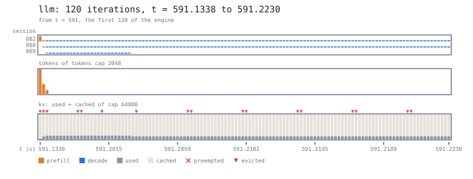
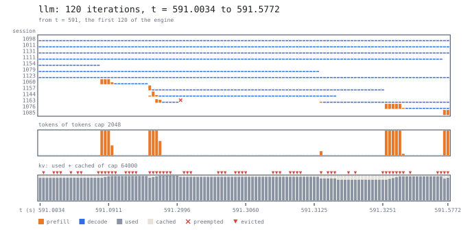

# 6. The cliff

Sweep the arrival rate to find where latency rises sharply, then vary memory
to see how cache pressure affects that threshold.

## The sweep

```bash
for L in 1.5 1.7 1.8 1.9 2.0; do
  serq run docs/tutorial/programs/05-engine.sq --workload docs/tutorial/programs/workloads/05-engine.sq --horizon 20000 --warmup 2000 --seed 1 --Lambda $L --json
done
```

| sessions/s | from cache | TTFT (s) | preemptions | `stuck` | utilisation |
|---|---|---|---|---|---|
| 1.5 | 0.442 | 0.131 | 350 | 0 | 0.598 |
| 1.7 | 0.326 | 0.263 | 1,104 | 0 | 0.726 |
| 1.8 | 0.249 | 0.513 | 1,973 | 0 | 0.803 |
| 1.9 | 0.150 | 1.532 | 3,659 | 0 | 0.895 |
| 2.0 | 0.032 | 25.124 | 6,484 | 0 | 1.000 |

*From cache* is the `llm` row's `token hit` in the report's engine table
(`engines.llm.token_hit` in the JSON): the share of the admitted tokens the
cache supplied. A request preempted and admitted again counts its tokens
again, and `readmits` counts those admissions (5 953 at 2.0)
([engine statistics](../reference/cli.md#engine-statistics)). TTFT is the
`client` section's mean, preemptions and `stuck` the `kv` pool's,
utilisation the `llm` stage's.

A mean from one run is a level only if a longer run gives about the same.
The same seed at longer horizons:

```bash
for H in 20000 40000 80000 160000 320000; do
  for L in 1.5 1.7 1.8 1.9 2.0; do
    serq run docs/tutorial/programs/05-engine.sq --workload docs/tutorial/programs/workloads/05-engine.sq --horizon $H --warmup 2000 --seed 1 --Lambda $L --json
  done
done
```

| sessions/s | TTFT (s) at 20 000 | 40 000 | 80 000 | 160 000 | 320 000 | from cache at 320 000 |
|---|---|---|---|---|---|---|
| 1.5 | 0.131 | 0.132 | 0.132 | 0.136 | 0.137 | 0.438 |
| 1.7 | 0.263 | 0.297 | 0.288 | 0.312 | 0.313 | 0.312 |
| 1.8 | 0.513 | 0.623 | 0.601 | 0.666 | 0.663 | 0.233 |
| 1.9 | 1.532 | 2.317 | 2.309 | 2.284 | 2.295 | 0.131 |
| 2.0 | 25.124 | 32.977 | 62.878 | 125.442 | 285.360 | 0.031 |

Up to 1.9 the TTFT has a level: about 0.14 s at 1.5, 0.31 s at 1.7,
0.6 s at 1.8 and 2.0 s at 1.9 (the last two the mean of seeds 1–3 at
320 000 s). The level at 1.9 is noisy: at 320 000 s, seeds 1–3 give 2.29,
1.68 and 1.93 s, each with a 95 % interval of ±0.3–0.5 s within its run
(at 1.8 they give 0.66, 0.57 and 0.57 s). With seed 1 the 20 000 s runs
at 1.8 and 1.9 read below the level: the queue's long excursions are
rare, and a short run may not sample one; another seed may read above
it. Only 2.0 has no level: its TTFT
keeps growing with the run length, so 25.12 s is one moment of a queue
without bound.

The cliff is between 1.9 and 2.0 sessions/s, and latency rises steeply
before it: the level doubles from 1.7 to 1.8 and grows about 3.3 times
from 1.8 to 1.9. The share of admitted tokens from cache at 320 000 s falls
from 0.44 at 1.5 to 0.13 at 1.9, and to 0.03 at 2.0.

No run here reports a `stuck` session (a request preempted again without
progress); when one does, its latency samples do not describe all
offered traffic. Inspect these counters, and the run length, before using
a mean for capacity planning, and repeat the experiment across seeds.

Measured 2026-10-15 on serQ afee627 with whole token counts (#661, #700), by
the commands on this page (seeds 2 and 3:
`--seed 2`, `--seed 3` at `--horizon 320000`); `readmits` since #594.

## Is it just saturation?

To separate compute saturation from memory pressure, run the same loads
with ten times the KV pool and the same cost model:

```bash
serq run docs/tutorial/programs/05-engine.sq --workload docs/tutorial/programs/workloads/05-engine.sq --horizon 20000 --warmup 2000 --seed 1 --Lambda 2.0 --blocks 40000
serq run docs/tutorial/programs/05-engine.sq --workload docs/tutorial/programs/workloads/05-engine.sq --horizon 20000 --warmup 2000 --seed 1 --Lambda 3.0 --blocks 40000
```

| sessions/s | KV blocks | from cache | TTFT (s) | preemptions | utilisation |
|---|---|---|---|---|---|
| 2.0 | 4,000 | 0.032 | 25.124 | 6,484 | 1.000 |
| 2.0 | 40,000 | 0.832 | 0.020 | 0 | 0.470 |
| 3.0 | 40,000 | 0.832 | 0.023 | 0 | 0.634 |

At 2.0 sessions/s, the larger pool turns a queue that grows without bound
(25.12 s at this horizon) into a TTFT of 0.020 s. Both larger-pool runs have no preemptions.
Memory capacity changes the amount of recomputation, even with the same
arrival rate and engine cost model.

## The loop

```
    memory is tight
          │
          ▼
 prefixes get evicted ──────┐
          │                 │
          ▼                 │
   turns miss, and a        │
   miss recomputes the      │
   whole context            │
          │                 │
          ▼                 │
  each turn costs the       │
  engine more              │
          │                 │
          ▼                 │
  turns stay resident       │
  longer, holding KV ───────┘
```

Eviction and recomputation can reinforce each other: longer service keeps
more KV resident, leaving less room for cached prefixes. The sweep shows a
sharp change in observed latency, but does not establish multiple stable states.

For comparison with a measured A100 deployment and a cache-policy
experiment, see the [vLLM use case](../use-cases/vllm.md).

## One engine, iteration by iteration

The table says that the engine is busy at 2.0 and the latency grows, not
what it is busy with. Log a run and draw 120 of its engine's iterations
(the [iteration view](../visualization/iterations.md)):

```bash
for L in 1.5 2.0; do
  serq run docs/tutorial/programs/05-engine.sq --workload docs/tutorial/programs/workloads/05-engine.sq --horizon 600 --seed 1 --Lambda $L --log cliff-$L.json
  serq draw --log cliff-$L.json --from 591 --iterations 120 --format svg --out cliff-$L.svg
done
```

A column is an iteration; a row a session; a cell its tokens in that
iteration, orange in a prefill and blue in a decode; under them, the
iteration's tokens against the 2048-token cap and the KV pool, allocated
(grey) under cached (beige), against its 64 000 units. A triangle is an
eviction, a cross a preemption.

At 1.5 sessions/s:



At 2.0 sessions/s:



At 1.5 the batch is at most three sessions and the pool is full of cache:
128 to 611 of its 4000 blocks allocated, the rest cached, so a new
block evicts an old one now and then (17 columns), and the cache supplies
0.39 of the prompt tokens over the run. At 2.0 the same 120 iterations hold 13
sessions, at most 9 at once of the 16 `reqs cap` allows; the pool is
allocated to 3381–4000 blocks with at most 618 cached, half the columns
evict, and one request is preempted when the blocks run out. The tokens
are not what is short: an iteration takes 249 of its 2048 on average.
What is short is blocks, and the cache they would have held (it supplies
0.08 of the prompt tokens over the run): the 17 prefill columns recompute
contexts the cache lost, and take 95 % of the window's time. That is the loop above, drawn: the queue behind the batch
(23 sessions waiting on average over these 600 s, `reqs`'s `queue`) is
what the latency measures, and the figure does not draw it.

The logs are large (41 MB at 2.0, 88 MB at 1.5 for 600 s: at 1.5 the
engine iterates three times as often, small batches of decodes being
short iterations).

Measured 2026-10-23 on serQ with `iter`'s `evicted` and the log's pool
caps (#22), by the commands above.

## What to try

Vary one parameter at a time:

```bash
# more memory
serq run docs/tutorial/programs/05-engine.sq --workload docs/tutorial/programs/workloads/05-engine.sq --horizon 20000 --warmup 2000 --seed 1 --Lambda 1.8 --blocks 8000
# fewer concurrent requests
serq run docs/tutorial/programs/05-engine.sq --workload docs/tutorial/programs/workloads/05-engine.sq --horizon 20000 --warmup 2000 --seed 1 --Lambda 1.8 --max_seqs 8
# shorter thinking time
serq run docs/tutorial/programs/05-engine.sq --workload docs/tutorial/programs/workloads/05-engine.sq --horizon 20000 --warmup 2000 --seed 1 --Lambda 1.8 --Z 1
```

---

Next: [a real system written in
it](../use-cases/vllm.md), or [the reference](../reference/cheatsheet.md).
