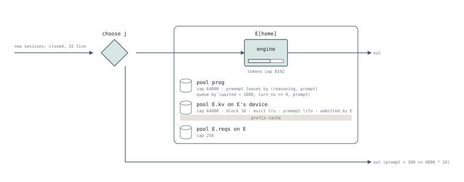

# ThunderAgent: program-aware scheduling for agents

`examples/multi-turn/thunderagent.sq` models
[ThunderAgent](https://github.com/ThunderAgent-org/ThunderAgent)'s router in
front of two vLLM replicas, with a fixed number of agents running at once,
as in a rollout or a benchmark run. The router schedules *programs*, each
an agent's whole trajectory, rather than requests. A program is placed on a
replica at its first request and stays there until it is paused. Its tokens count against the
replica's KV capacity while it reasons and while it calls a tool. When a
running program outgrows the replica, the router pauses idle programs, the
smallest first, and a paused program's next request waits to be let in
again.

The source correspondence uses ThunderAgent
[`7ddc861`](https://github.com/ThunderAgent-org/ThunderAgent/tree/7ddc8610270e56d3b109eed8796b3a4360fc67c9)
and its paper ([arXiv 2602.13692](https://arxiv.org/abs/2602.13692)).
Where the two differ, the program follows the code. This is a reduced
simulation model: it is not checked against ThunderAgent by a differential
test, and its costs are not fitted to hardware.



The router chooses a replica (`choose j`), and a program's tokens are its
lease of that replica's `pool prog`, beside vLLM's own `pool E.kv` and
`pool E.reqs`; its [`queue by`](../api/pool.md#queue) and
[`preempt leases by`](../api/pool.md#preempt) are the router's order and
pause rule, read in the table below. The lower exit is a prompt the
replica's KV cannot hold: the router ends that trajectory before it
chooses, as vLLM would refuse the request.

## Configuration

Each replica is `examples/pd-disaggregation/llmd_nixl_pull.sq`'s local
decoder: vLLM's engine with a block prefix cache of 4 000 blocks of 16
tokens. Thirty-two agents run at once (`arrive closed(N)`). A task's first
prompt is 4 000-8 000 tokens, each step adds about 1 000 tokens of
observation and 300 of answer, and an agent calls a tool for 3 s on average
between steps. The device's constants are of the order of a 32B model on
one GPU, an iteration of 20 ms. Pass `--tr 0` for the router's
`default` mode, which places a new program on the replica with the fewest
programs and never holds one back.

## In serQ

```serq title="examples/multi-turn/thunderagent.sq"
--8<-- "examples/multi-turn/thunderagent.sq"
```

### The router

The router's view of a replica is the pool `prog[j]`, in tokens, beside
the replica's own KV pool. A program holds its tokens there as a
[`lease`](../api/statements.md#hold), which outlives the request so that the
tokens stay counted through the tool call. A running program's next turn
grows its lease; when the growth does not fit,
[`preempt leases by`](../api/pool.md#preempt) ends idle programs' leases,
the smaller first, and [`allocated`](../api/functions.md#allocated) tells
a program whose lease has gone that it must be let in again.

| ThunderAgent | The program |
|---|---|
| A replica's capacity, `cache_config.total_tokens_capacity`, against `active_program_tokens + buffer` ([`backend/state.py#L185-L194`](https://github.com/ThunderAgent-org/ThunderAgent/blob/7ddc8610270e56d3b109eed8796b3a4360fc67c9/ThunderAgent/backend/state.py#L185-L194)) | `pool prog[J] { cap tr ? room : inf; … }`, one member per replica, `room` the replica's `kv` less the shared prompt when it is counted once |
| `BUFFER_PER_PROGRAM = 100` per active program ([`backend/state.py#L23`](https://github.com/ThunderAgent-org/ThunderAgent/blob/7ddc8610270e56d3b109eed8796b3a4360fc67c9/ThunderAgent/backend/state.py#L23)) | `let buffer = 100;`, in every amount of `prog` |
| The scheduler loop: every `--scheduler-interval`, 5 s by default, it lets waiting programs in, then pauses ([`__main__.py#L28`](https://github.com/ThunderAgent-org/ThunderAgent/blob/7ddc8610270e56d3b109eed8796b3a4360fc67c9/ThunderAgent/__main__.py#L28), [`scheduler/router.py#L746-L771`](https://github.com/ThunderAgent-org/ThunderAgent/blob/7ddc8610270e56d3b109eed8796b3a4360fc67c9/ThunderAgent/scheduler/router.py#L746-L771)) | `stage tick : delay;` and `run tick (cost(tick, floor(now, dt) + dt - now))`: a wait for the next tick |
| A new program goes to the replica with the fewest active tokens among those where it fits, if no program waits; else it waits in the global queue ([`scheduler/router.py#L330-L362`](https://github.com/ThunderAgent-org/ThunderAgent/blob/7ddc8610270e56d3b109eed8796b3a4360fc67c9/ThunderAgent/scheduler/router.py#L330-L362)) | `choose j in J by (free(prog[j]) >= charged ? 0 : 1, used(prog[j]))`, then a `hold` of `prog[j]`, unless `used(waiting_queue) > 0` or no replica has room |
| The global waiting queue ([`scheduler/router.py#L560-L571`](https://github.com/ThunderAgent-org/ThunderAgent/blob/7ddc8610270e56d3b109eed8796b3a4360fc67c9/ThunderAgent/scheduler/router.py#L560-L571)) | `pool waiting_queue`, which a program holds while it waits for ticks |
| The program's tokens are counted while it reasons and while it calls a tool, at `acting_token_weight` 1.0, the default ([`backend/state.py#L104-L107`](https://github.com/ThunderAgent-org/ThunderAgent/blob/7ddc8610270e56d3b109eed8796b3a4360fc67c9/ThunderAgent/backend/state.py#L104-L107), [`__main__.py#L30`](https://github.com/ThunderAgent-org/ThunderAgent/blob/7ddc8610270e56d3b109eed8796b3a4360fc67c9/ThunderAgent/__main__.py#L30)) | `lease prog[home] (inf)`: the allocation outlives the hold |
| A running program's next request is let through without a capacity check; its count becomes the new prompt's estimate, its characters over a ratio learnt from earlier responses ([`scheduler/router.py#L384-L389`](https://github.com/ThunderAgent-org/ThunderAgent/blob/7ddc8610270e56d3b109eed8796b3a4360fc67c9/ThunderAgent/scheduler/router.py#L384-L389), [`#L450-L458`](https://github.com/ThunderAgent-org/ThunderAgent/blob/7ddc8610270e56d3b109eed8796b3a4360fc67c9/ThunderAgent/scheduler/router.py#L450-L458), [`#L479-L491`](https://github.com/ThunderAgent-org/ThunderAgent/blob/7ddc8610270e56d3b109eed8796b3a4360fc67c9/ThunderAgent/scheduler/router.py#L479-L491)) | `charged`, the prompt off by at most `est` (0: exact), to which the lease grows or shrinks |
| After the response, the count is the response's usage, the answer included ([`scheduler/router.py#L493-L494`](https://github.com/ThunderAgent-org/ThunderAgent/blob/7ddc8610270e56d3b109eed8796b3a4360fc67c9/ThunderAgent/scheduler/router.py#L493-L494)) | the lease grows or shrinks to `prompt + o + buffer` after the engine's request |
| An ACTING program counts `acting_token_weight` of its tokens ([`backend/state.py#L104-L107`](https://github.com/ThunderAgent-org/ThunderAgent/blob/7ddc8610270e56d3b109eed8796b3a4360fc67c9/ThunderAgent/backend/state.py#L104-L107)) | `shrink prog[home] (cost(prog, (1 - w) * (allocated(prog[home]) - buffer)))` after the response, grown back at the next request |
| Over capacity, pause the ACTING programs, the smallest first, then the REASONING ones ([`scheduler/router.py#L773-L805`](https://github.com/ThunderAgent-org/ThunderAgent/blob/7ddc8610270e56d3b109eed8796b3a4360fc67c9/ThunderAgent/scheduler/router.py#L773-L805)) | `preempt leases by (reasoning, prompt) every (dt) suspend;` on `prog`: a growth goes through, and at the tick idle programs' leases are set aside first, the smaller first |
| A paused program with no request pending is let in again at a later tick if it fits, last of the groups, smallest first ([`scheduler/router.py#L851-L866`]({TA}/scheduler/router.py#L851-L866)) | `suspend`: the tick gives a set-aside lease back, before it pauses, if it fits |
| A paused program's next request waits for a tick that lets it in, on the replica with the most room if one has room for it, wherever it was before ([`scheduler/router.py#L411-L424`](https://github.com/ThunderAgent-org/ThunderAgent/blob/7ddc8610270e56d3b109eed8796b3a4360fc67c9/ThunderAgent/scheduler/router.py#L411-L424), [`#L807-L932`](https://github.com/ThunderAgent-org/ThunderAgent/blob/7ddc8610270e56d3b109eed8796b3a4360fc67c9/ThunderAgent/scheduler/router.py#L807-L932)) | `allocated(prog[home])` is 0: the program releases what is set aside, waits for the next tick, then for the next while `no_room(charged)`, and is placed as a new one |
| A program that has waited 30 minutes is let in whatever the capacity; at a tick, programs with a pending request, then new ones, each group smallest first ([`#L934-L956`](https://github.com/ThunderAgent-org/ThunderAgent/blob/7ddc8610270e56d3b109eed8796b3a4360fc67c9/ThunderAgent/scheduler/router.py#L934-L956), [`scheduler/router.py#L851-L866`](https://github.com/ThunderAgent-org/ThunderAgent/blob/7ddc8610270e56d3b109eed8796b3a4360fc67c9/ThunderAgent/scheduler/router.py#L851-L866)) | after 1 800 s the program stops waiting for ticks and waits for room in its replica's queue; programs let in at one tick go in the order they reach it |
| `/programs/release` at the end of the trajectory ([`scheduler/router.py#L514-L547`](https://github.com/ThunderAgent-org/ThunderAgent/blob/7ddc8610270e56d3b109eed8796b3a4360fc67c9/ThunderAgent/scheduler/router.py#L514-L547)) | the session's end ends the lease |
| `--router default`: the replica with the fewest programs, no capacity ([`scheduler/router.py#L252-L271`](https://github.com/ThunderAgent-org/ThunderAgent/blob/7ddc8610270e56d3b109eed8796b3a4360fc67c9/ThunderAgent/scheduler/router.py#L252-L271)) | `tr = 0`: `cap inf` and `choose … by (0, holders(prog[j]))` |

ThunderAgent's wiki writes the capacity with the prefix cache's savings
(`shared_tokens`) subtracted. At `7ddc861` nothing updates that value, so
it stays 0, and the program leaves it out.

## Run it

```bash
cargo run --release -- run examples/multi-turn/thunderagent.sq --horizon 25000 --warmup 5000
cargo run --release -- run examples/multi-turn/thunderagent.sq --horizon 25000 --warmup 5000 --tr 0
```

The report's `reused_tokens` and `prefill_tokens` give the token hit rate
of the tables below, reused over the two together (vLLM's
`prefix_cache_hits` over `prefix_cache_queries`); the report's own `hit`
row is something else, the share of turns with any block of the
program's own cached. Steps/min are `turns` × 60 / (horizon − warm-up). `resume_wait` is how long a paused program waited
to be let in again. `tools/thunderagent/sweep.py` runs both modes over the
agent counts, four seeds each, and prints the tables below. A run needs
thousands of seconds before the agents' contexts settle: a 3 000 s run
measures them before the longest have grown. Seeds move a ratio by about
0.2. Every number on this page is a simulation of the program, not a
measurement.

| Argument | Default | Meaning |
|---|---|---|
| `tr` | 1 | 1 for TR mode, 0 for `default` mode |
| `N` | 32 | agents at once |
| `blocks` | 4 000 | KV blocks of 16 tokens per replica |
| `Z` | 3 | mean tool time, seconds |
| `a`, `omega`, `beta` | 2e-4, 0.02, 2e-7 | compute per token, weights read per iteration, KV read per context token per iteration (s) |
| `g` | 0 | a prefill's attention per token and context token (s): with it, recomputing a context costs its square |
| `S` | 0 | tokens of a system prompt every program starts with, which vLLM caches once |
| `count_shared` | 1 | 1: the router counts the shared prompt in every program, as the code does; 0: once, as ThunderAgent's wiki writes the capacity |
| `w` | 1 | `--acting-token-weight`: a program calling a tool counts this share of its tokens |
| `dt` | 5 | `--scheduler-interval`: seconds between the router's ticks, at which waiting programs are let in |
| `est` | 0 | the router's relative error, at most, in estimating a request's tokens before it is sent (0: exact) |

## What the runs show

At the example's configuration:

| N | TR steps/min | default steps/min | ratio | TR token hit | default token hit |
|---|---|---|---|---|---|
| 4 | 21.4 | 21.1 | 1.01 | 0.90 | 0.88 |
| 8 | 28.9 | 24.1 | 1.20 | 0.83 | 0.53 |
| 16 | 27.5 | 18.7 | 1.47 | 0.70 | 0.02 |
| 32 | 26.6 | 18.6 | 1.43 | 0.65 | 0.01 |
| 48 | 26.6 | 18.6 | 1.43 | 0.65 | 0.02 |

A step is a reasoning and an acting period, the paper's unit. While the
agents' contexts fit, the two modes serve the same. Past that, default
mode lets every agent in, the caches thrash, and almost every turn
recomputes its whole context. TR mode keeps the prefixes of the programs
it runs and serves about 1.4 times the steps. The gain is paid in
waiting: TR mode's mean time to first token is lower (56 s against 81 s
at 32 agents), but its 99th percentile is 376-540 s against 140 s, since a
program held back waits for the router's ticks until a replica has room
for it. Under open arrivals of programs the two
modes serve alike at rates default mode keeps up with; a little above
them (0.04 programs a second) only TR mode keeps up, and above that
neither does.

`tools/thunderagent/sweep.py --preset paper` runs the scale of the paper's
evaluation instead. Each replica is a GLM-4.6-class model in FP8 weights
on one 8×H100 node with a BF16 KV: about 500 000 tokens of KV, `a` 1.6e-5,
`omega` 0.015, `beta` 1.4e-8, `g` 3.3e-9, and a 3 968-token system prompt
every program shares (`S`). These are estimates from the model's size,
not a fit:

| N | TR steps/min | default steps/min | ratio | TR token hit | default token hit |
|---|---|---|---|---|---|
| 24 | 170.8 | 170.9 | 1.00 | 0.94 | 0.94 |
| 48 | 293.9 | 284.7 | 1.03 | 0.94 | 0.93 |
| 96 | 308.4 | 100.6 | 3.06 | 0.91 | 0.24 |
| 144 | 307.6 | 99.5 | 3.09 | 0.91 | 0.23 |
| 192 | 307.8 | 99.4 | 3.10 | 0.91 | 0.23 |

The paper's SWE-agent runs on GLM-4.6 (Fig. 4a and Fig. 5a, read from the
figures) serve 218, 275, 162 and 140 steps/min under vLLM and 220, 350,
382 and 370 under ThunderAgent at 24-96 programs, with hit rates falling
to 30 % and 93 %; the printed ratio is 2.65, and the coding agents' range
is 2.43-3.58. These runs have the same shape: the two modes serve alike
while the contexts fit, then TR mode's throughput levels off while
default mode's falls to a third and stays there. Each part of the result
depends on one argument:

| Arguments (from the preset) | Ratio at N = 96-192 | TR token hit | default token hit |
|---|---|---|---|
| preset | 3.1 | 0.91 | 0.23-0.24 |
| `S` 0 | 2.4 | 0.72-0.73 | 0.01 |
| `count_shared` 0 | 2.3 | 0.76-0.77 | 0.23-0.24 |
| `g` 0 | 1.2 | 0.91 | 0.23-0.28 |
| `g` 1.1e-9 | 1.9 | 0.91 | 0.23-0.26 |
| `Z` 1 s / 10 s | 3.3 / 2.0-2.1 | 0.90 | 0.23-0.29 |
| `dt` 2 s / 10 s | 3.0 / 3.1 | 0.88-0.89 / 0.92 | 0.23-0.24 |
| `est` 0.2 | 3.0 | 0.90 | 0.23-0.24 |

- **The cost of a recompute sets how much the knee costs.** With prefill
  linear in its tokens (`g` 0), default mode loses little by recomputing.
  With the attention term, recomputing a long context costs its square,
  the paper's argument (Eq. 8), and default mode loses two thirds of its
  throughput past the knee, as the paper's vLLM loses half to two thirds.
- **The router's overcount of the shared prompt keeps paused prefixes.**
  About 11 % of TR mode's turns come from a paused program. The router
  counts the shared prompt in every program's tokens, but vLLM stores it
  once, so the KV the router never lets in keeps the paused prefixes
  cached. Counted once, the paused programs recompute: TR mode's hit rate
  falls to 0.76 and the ratio to 2.3.
- **Default mode's hits are the shared prompt.** Its own prefixes survive
  in 1.5-4.5 % of turns; the rest is the prompt, 3 968 of a mean 18 000
  tokens. `S` was chosen to bring it near the paper's 30-38 %; the paper
  does not state its prompts' length.
- **Long tools bound the gain.** A program calling a tool holds its KV
  while the GPU does not run it. The paper's smallest gains are on its
  workloads with the longest tools (ScienceAgent 1.24, ToolOrchestra
  1.48); ToolOrchestra also runs Qwen3-8B on an RTX 5090.
- **The tick's interval agrees with the paper's ablation in one step of
  three.** At `dt` 2, 5 and 10 s TR mode serves 297, 308 and 309
  steps/min, against the paper's 363, 378 and 343 (Fig. 6b): both rise
  3-4 % from 2 to 5, then the paper's falls and the program's does not.
  The paper's runs have the decay, which the program does not write.
- **The headline ratio rests on two estimates.** 3.1 is with `g` at the
  pessimistic end of its range and `S` chosen; with `g` 1.1e-9 it is 1.9.
  The tables show which mechanisms produce a gain of the paper's size,
  not that the program reproduces a panel.

## Limitations

- **One shared prompt.** `S` is one system prompt every program starts
  with, shared in each replica's cache as vLLM shares it. Programs that
  share more, such as part of a task, are not written.
- **Pauses are immediate.** ThunderAgent lets programs in at its ticks,
  as the program does, but it also pauses only at its ticks and lets a
  replica overflow in between. The program pauses at the growth that does
  not fit.
- **No early resume, and no order at a tick.** ThunderAgent may let a
  paused program in again while it still calls its tool, and lets the
  programs back at one tick in by priority, smallest first. Here a paused
  program comes back at its next request, and programs back at one tick
  go in the order they reach it.
- **The force-resume is within the capacity.** ThunderAgent lets a program
  in after 30 minutes of waiting whatever the capacity. The program stops
  waiting for ticks then and waits for room.
- **A pause ends the count at once.** ThunderAgent counts a reasoning
  program it has marked for a pause until its response arrives; at the
  paper's scale a reasoning program is paused in 0.04 % of turns.
- **The decay is not written.** `w` is ThunderAgent's
  acting weight, which the router reads wherever it reads a replica's
  room. Counting idle programs for less costs throughput here: at the
  paper's scale the ratio is 3.1 at `w` 1, 2.2 at 0.5 and 1.4-1.5 at 0,
  because their next requests grow back and pause others. The `2^-t`
  decay the paper's experiments use weighs idle programs by the time they
  have waited, and only when programs are let in; it is off in the code
  by default, and the program does not write it. What it changes is how
  soon a paused program is let in again, while it still calls its tool,
  which the program does not write either (the design record, item 6;
  #587).
- **The paper is not fitted.** It does not state its KV capacity, context
  lengths, output lengths, coding tools' times, system prompts or vLLM
  version, so `g` and `S` are estimates and no panel is reproduced.
