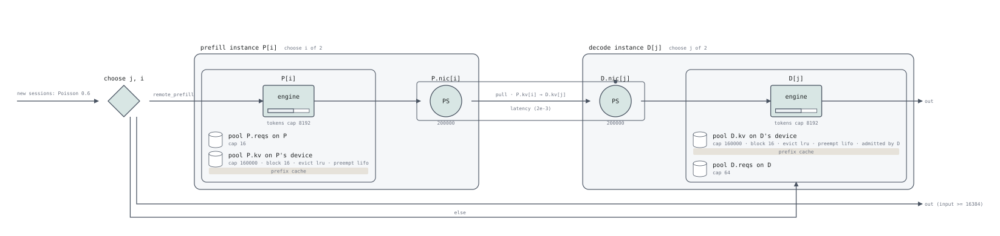
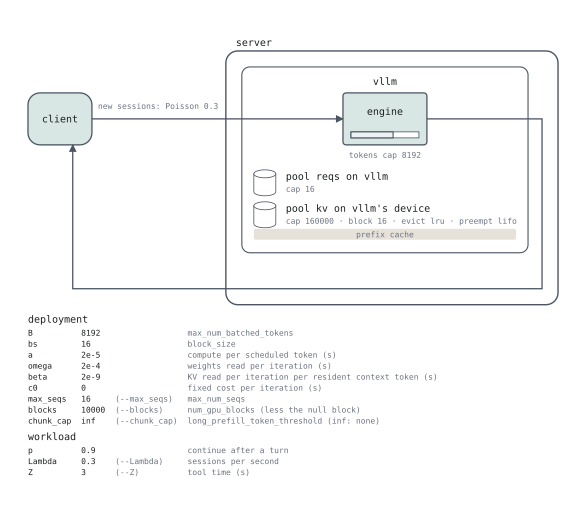
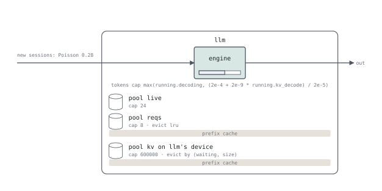
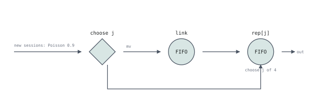

# The deployment view

The program as a queueing network.

That is `examples/pd-disaggregation/llmd_nixl_pull.sq`: two prefill and two decode
instances, the KV read over NIXL. Each filled panel is an instance: what the
router's `choose` picks, a pod with its engine, its NIC and its pools; the
engine's slots and KV blocks are drawn in the engine's frame. The
read crosses from the prefiller's box to the decoder's: it holds the
prefiller's NIC and the decoder's at once, so its two stations are bracketed
as one job, and what it moves (`P.kv[i] → D.kv[j]`: the prefiller's blocks
stay leased until it ends, the decoder's are allocated before it starts) and
the link's latency are written on it.

## Request flow

For a program with a `server` or gateway, the figure shows one request's
path. Workload tool calls, subsequent turns and session exits are omitted,
but holds surrounding the workload's `request` remain visible. The figure
reads the request from the IR (`sides`), so a program, its JSON IR and a
compiled `pyserq.Program` draw
the same figure. Two requests are the same when they run the same
statements inside workload holds of the same pools, whatever the units;
when the session's requests differ, the figure shows the full session.
A pool the request holds encloses the stations it reaches while it holds
it: in a hold's scope, past it while a `lease` lasts, until the `release`
that ends it, and after a `grow` of a pool held in no scope, which grows
the session's lease. After a branch or a loop a pool stays held where
every way through holds it, whichever hold took it on each.

| Element | Meaning |
|---|---|
| Station | A stage reached by a `run`; an array is labelled with its size. Consecutive prefill and decode runs at one engine share a station. |
| Arrow | Request flow between stages, including branches and loop returns. Guards label alternatives; `out` marks an exit. |
| Decision diamond | A branch or routing decision before the first station. |
| Filled panel | An instance selected by `choose`, grouping the engine, NIC and pools indexed by exactly its variable. One the session also indexes otherwise (`E[j]`, `E[0]`) is in no panel; a panel takes in a dashed enclosure only when all of it stands inside. An instance's pool is drawn only inside its panel, so a station outside it does not show that hold; a run between stations the panels would pull apart is drawn outside them. |
| Dashed enclosure | A pool held across several stations. |
| Unfilled frame | Pools held at one station, listed below its glyph. |
| Transfer bracket | A job using both endpoints' NICs; its label names the source and destination KV. |
| Latency label | A delay before a single transfer. A delay leading to several transfers remains a station. |

The diagram simplifies control flow. Consecutive visits to one station do
not add an arrow, and guard chains with no intervening station collapse.
A guard fixed by earlier constant assignments can omit an arm with no
station; parameter-controlled alternatives remain visible. Inspect the
program when you need the exact execution path.

That is `examples/multi-turn/vllm.sq`. Its request slot (`reqs`) and its
KV blocks (`kv`) are held only at `vllm`, so they are drawn in its frame.
The tool call and the next turn are the workload's, so the figure has
neither: a request arrives at `vllm` and goes out.

## Addressing the figure

The SVG is a picture that a page can also address. Each station's shapes
are grouped under its stage's name, `<g data-stage="P">` (an array's
members share the name: `P[0]` and `P[1]` are one station, `P`); a queue
glyph and a drum carry their pool, `<g data-pool="P.reqs">`; the arrival
arrow is `data-role="arrival"`, an exit arrow `data-role="exit"`, and the
used part of an engine's budget bar `data-role="budget"`. A decision
diamond is no stage and has no name. That is what
[serq-lar](https://github.com/servingQ/serq-lar) animates a
[run log](../reference/log.md) over: it finds a station by what the
program calls it, so a change of layout moves nothing but the picture. The
TikZ writer ignores the ids.

## Glyphs

| IR | Glyph |
|---|---|
| `Fifo(c)` | circle, `FIFO`, the server count when `c ≠ 1` |
| `Ps(φ)` | circle, `PS`, with `φ` beneath |
| `Delay` | rounded box with a duration-density glyph: decaying for `~exp` and `~h2`, a hump for `~erlang`, flat for `~uniform`, a spike for a deterministic duration. Other or long expressions use a row of small circles for infinite servers |
| `Step { … }` | rounded box with a token-budget bar: an iterating engine, not a queueing station. It is labelled `engine` and `tokens cap B` in the engine form's words, the residents' totals as `running.count`, `running.decoding` and `running.kv_decode`; the IR keeps no form, so a step stage read from IR is drawn the same |
| a pool | a drum, its capacity and options written beside it (`cap 8192 · block 16`) |
| a pool held at one station alone | a row in the station's unfilled frame, under its glyph: drum, name, options |
| a pool held across several stations | dashed rounded box, the drum and options in the column at its left |
| a pool a hold caches in | a grey strip under its row, or along the bottom of its box |
| the queue a hold waits in | ahead of a dashed box, one per hold rather than per pool: a hold of several pools joins the queue of its first. A frame draws none: its pools are taken at its entrance |
| a step stage's `memory` | `pool X on S's device` as the pool's title: the engine form's pool on the device, which the IR does not name; `admitted by T` among its options when a stage `T` admits it |
| a pool `S` admits (`admit_via` `S`: `pool X on S`, `on S.D`) | `pool X on S` as the pool's title, unless it is `S`'s memory; from a dashed box, also a dashed edge from the queue to `S` |

A pool's eviction order is drawn only where something is cached in it: an order
over an empty cache says nothing.

### Which pool holds the cache

A hold with a `growing` run caches in that pool alone. A hold without one
caches in all its pools. The cache strip follows this behavior, rather
than assuming every cached pool represents KV memory.

## Nesting

`replica.sq`'s workload holds `live` for a session's whole conversation,
and its server holds `reqs` and `kv` only around the engine. A request is
served inside the workload's hold, so `live` is drawn too. All three are
held at `llm` alone, so all three are rows in its frame.

## A program that holds nothing

`routing.sq` has no pools at all. The figure therefore has no pool enclosures. The `choose j of 4` under `rep[j]` is the routing policy.
